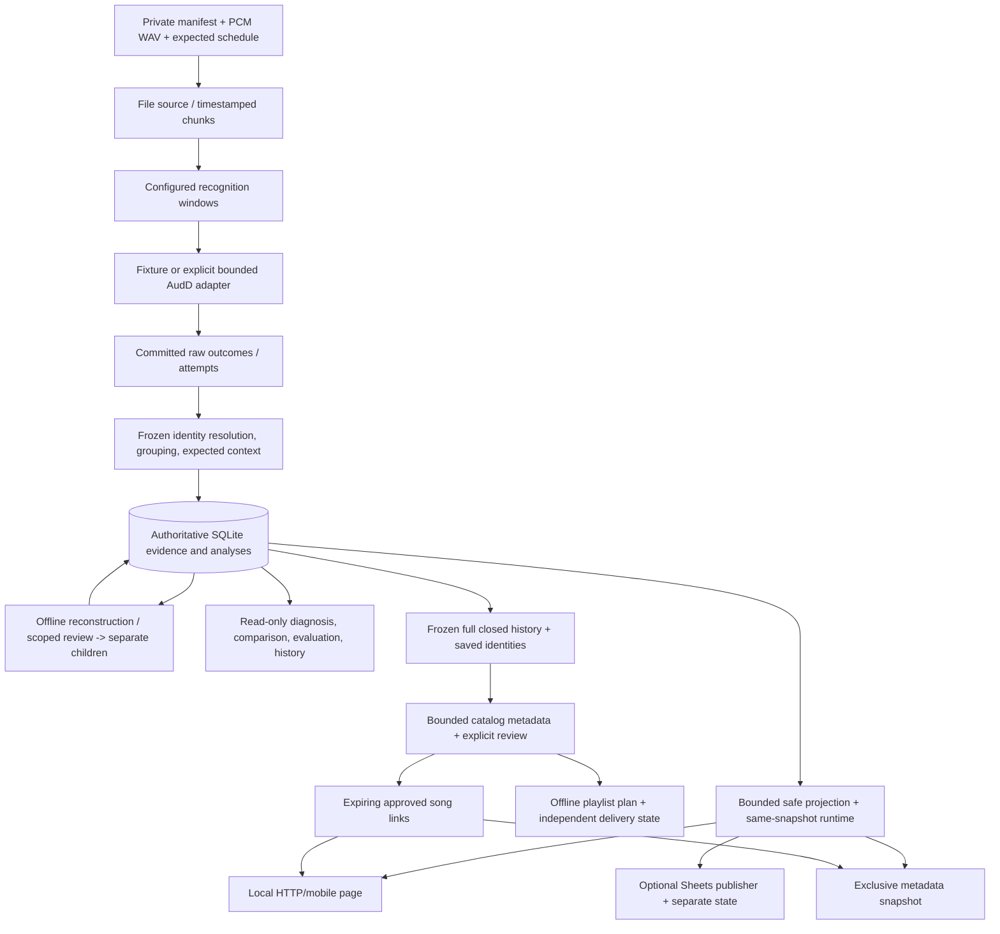

# Developer guide

Read [AGENTS.md](../AGENTS.md), [status](status.md) and the [active roadmap](implementation-plan.md) first. The [feature index](index.md#current-feature-guides) leads to supported contracts; the [detailed development contracts](development-contracts.md) retain specialized persistence, recovery and output invariants. Historical plans explain earlier decisions and proposed names; current source/guides define the implemented interface.

## Architecture



Recognition/output calls occur outside database transactions. Raw results commit before derivation; only closed plays persist. Readers use short consistent read-only snapshots. The separate [supervised recorder](microphone-capture.md) writes finalized WAVs and immutable capture sidecars, then explicitly seals reviewed-clock manifests for this existing file pipeline. It does not stream into recognition or change fixed-length source contracts. The [prototype hardware](prototype-hardware.md), [setup guide](pi-setup.md) and [first-capture plan](pi-bring-up-plan.md) separate synthetic software checks from pending Linux/Pi acceptance and later live coordination.

## Module map

Paths below are relative to `src/wcs_event_recorder/`. Start at the coordinating module, then follow its domain validator. Do not spread domain policy into CLI or HTTP handlers.

| Responsibility | Modules |
| --- | --- |
| CLI registration and routing | `cli.py`, `cli_parser.py`; handlers in `cli_processing.py`, `cli_inspection.py`, `cli_output.py`, `cli_recovery.py`, `cli_phase2.py`, `cli_views.py`, `cli_music.py`, `cli_activity.py`, `cli_capture.py` |
| Source and time contracts | `models.py`, `inputs.py`, `audio.py`, `replay.py`, `windows.py`, `audio_preparation.py` |
| Supervised capture and Pi setup | `capture_config.py`, `capture_preflight.py`, `capture_process.py`, `capture.py`, `capture_artifacts.py`, `capture_sealing.py`; ordinary-user installer in `deploy/pi/`; [capture contract](microphone-capture.md) |
| Recognition and derived conclusions | `recognition.py`, `audd.py`, `resolution.py`, `aggregation.py`, `attribution.py`, `analysis.py` |
| Durable commits and frozen evidence | `storage.py`, `schema.py`, `run_store.py`, `persistence.py`, `attribution_store.py`, `evidence.py`, `read_evidence.py`, `lineage.py` |
| Shared collection and write guards | `collection_dispatch.py`, `write_progress.py`, `methods.py`; collection-specific stores remain separate |
| Reprocessing, recovery and checkpoints | `reprocessing.py`, `recovery.py`, `recovery_plan.py`, `recovery_store.py`, `saved_recovery.py`, `collection_analysis.py`, `checkpoints.py`, `checkpoint_io.py`, `missing_plan.py`, `missing_recovery.py`, `missing_store.py` |
| Review and reports | `revisions.py`, `comparison.py`, `diagnostics.py`, `evaluation.py`, `history.py`, `run_output.py`, `codecs.py` |
| Safe views and optional outputs | `views.py`, `view_runtime.py`, `view_config.py`, `web.py`, packaged `web_assets/`, `publication.py`, `sheets.py`, `sheets_state.py`, `output_paths.py` |
| Catalog selection and review | `music_selection.py`, `music_catalog.py`, `catalog_review.py`, `catalog_transport.py`, `catalog_spotify.py`, `catalog_apple.py` |
| Playlist plans, delivery and links | `playlist_plan.py`, `playlist_delivery.py`, `playlist_state.py`, `playlist_http.py`, `music_links.py`, `music_publication.py`; [contracts/capability limits](music-outputs.md) |
| Private activity foundation | `activity_artifacts.py`, `activity_labels.py`, `pcm_features.py`, `audio_features.py`, `feature_bundle.py`, `quiet_regions.py`, `activity_evaluation.py`, `activity_matching.py`, `activity_io.py`, `activity_report.py`, `cli_activity.py`; [labels](activity-labels.md), [features](audio-features.md), [quiet candidates](quiet-regions.md), [evaluation](activity-evaluation.md), [matching accounting](activity-boundary-matching.md), [reports](activity-report.md), [contracts](activity-contracts.md) |

`tests/` mirrors these contracts and includes real SQLite locks/commits, fault injection, legacy migrations, synthetic CLI acceptance and optional Chromium checks. `scripts/recorder_benchmarks/` supplies frozen compatibility evidence and bounded resource probes. Private/generated artifacts belong under ignored `data/`.

## Glossary

| Term | Meaning |
| --- | --- |
| Source / recording clock | Identified retained audio and the timezone-aware time of its first frame; independent of processing/replay speed |
| Frame | One simultaneous sample across all channels; offsets are integer frames, not bytes or channel samples |
| Window / observation | Configured audio span / saved recognition outcome for it, including no-match or error |
| Track / occurrence | Canonical recording identity / a separate estimated play; A–B–A produces two A occurrences |
| Resolution snapshot | Identity decision as saved for that analysis; later catalog changes must not rewrite it |
| Run / analysis | One selected interpretation with configuration, evidence links, conclusions, status and lineage |
| Collection / dispatch intent | Separately journaled recognition acquisition / a committed attempt boundary, which proves neither provider receipt nor billing |
| Frozen plan / catalog seed | Immutable bound inputs and starting identity universe used to reproduce a derivation |
| Coverage / `completed_partial` | Which configured windows supply selected outcomes / successful analysis of a supported saved prefix, not full-source completion |
| Censored boundary / historical EOF | A boundary not fully observed / whether the original recording actually reached its end; configured-grid recovery does not prove it |
| Checkpoint / workspace | Immutable whole-database capture / separately owned writable copy for reconstruction; captured `running` states remain unconfirmed |
| Revision / independent labels | Scoped human-reviewed conclusions in a new child / separately prepared source-hash-bound reference used for evaluation |
| Expected context | Schedule-derived session/DJ attribution, including ambiguity; not independently observed actual activity |
| View generation / observation key | Selection identity used to reset browser state / saved recognition identity used to expire unchanged hints; neither proves writer liveness |
| Publication / delivery state | Immutable metadata-only artifact / separate output bookkeeping, never core recording evidence |
| Output mapping / playlist plan | Explicit reviewed service recording decision / frozen deduplicated listening sequence with every source occurrence explained; neither changes canonical recognition identity |

## Verification

Use the installed environment from the repository root. Basic development requires `.[dev]`; HTTP checks need `web`, browser checks additionally need `web-test` and Chromium. Optional tests can skip when dependencies are missing; report such skips explicitly.

```powershell
.\.venv\Scripts\python.exe scripts/check_docs.py
.\.venv\Scripts\python.exe -m pytest -q
```

For a focused output change, install the optional extras, install Chromium once, then run the relevant files. A custom local browser path must match the one used at installation and testing:

```powershell
.\.venv\Scripts\python.exe -m pip install -e '.[dev,web,web-test]'
$env:PLAYWRIGHT_BROWSERS_PATH = Join-Path (Get-Location) 'data/tools/playwright'
.\.venv\Scripts\python.exe -m playwright install chromium
.\.venv\Scripts\python.exe -m pytest -q tests/test_sheets.py tests/test_web.py tests/test_web_browser.py tests/test_publication.py
```

For documentation-tool changes, run `tests/test_docs.py` and the checker; an application-wide regression is not implied. The checker only imports parser metadata and never executes documented examples. See [checker scope](documentation.md#automated-checker).

Use [frozen-corpus verification](benchmarks.md#verify-after-a-refactor) when changing shared evidence/read/report behavior. Never regenerate or normalize retained evidence to make compatibility pass. Run resource probes separately from heavy tests; preserve ordinary timing, allocation tracing and process-memory distinctions. The [storage limits](release-c-operating-limits.md) and [view limits](phase-3-operating-limits.md) describe measured developer envelopes, not larger-event guarantees.

Keep current behavior in feature guides and status; preserve completed plans and records as described in [documentation maintenance](documentation.md). Paid recognition, public hosting and real Sheets activation are outside deterministic checks.
