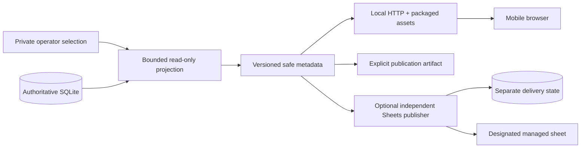

# Phase 3 execution plan: local music views and optional outputs

Status: All eight software steps implemented and verified. Local service/browser, runtime/replay, publication and optional Sheets software checks pass. Actual Sheets activation, public deployment and representative longer room-recording acceptance remain separate pending gates.

## Outcome and release boundaries

Provide an account-free, mobile-friendly view of explicitly selected event music metadata. Start with a local read-only recent-song page, then add refresh/replay behavior, publication selection, optional Google Sheets output and preparation for hosting/QR access. SQLite remains authoritative; an output failure must not affect recognition, recording or saved evidence.

The first usable release needs no longer recording, recognition requests, Sheets account, public hosting or microphone integration. Existing saved evidence and synthetic recordings can verify display behavior. Representative room-audio acceptance is required before claiming live event readiness or deploying the real event workflow publicly. An explicitly authorized synthetic demo is a separate capability, not evidence of acoustic acceptance.

| Release | Required scope | Gate |
| --- | --- | --- |
| A: local history view | Projection contract, explicit source selection, read-only HTTP server, responsive recent-song UI | Correct saved metadata, uncertainty and privacy; offline integration/browser checks |
| B: replay and refresh | Latest-recognition panel, source-time replay preview, bounded polling, failure/stale states, selection/publication artifacts | Honest clock/current-song semantics, concurrent-writer isolation and representative synthetic resource checks |
| C: optional operational output | Dry-run and isolated Sheets adapter with reconciled delivery state | Mocked failures/restarts/duplicates/corrections pass; actual target/account activation is separately authorized |
| D: publication preparation | Metadata-only artifacts, host/QR runbook, withdrawal and rollback | Local/replay acceptance complete; real public event deployment waits for recording acceptance and explicit hosting choices |

Releases A/B are the Phase 3 core. C is optional and cannot block the core. D can prepare a reviewable deployment without actually publishing it. Completion records must distinguish implemented software, mocked connector verification, actual connector activation and public event acceptance.

## Baseline and non-negotiable contracts

Start from the [Phase 2 completion record](phase-2-completion-plan.md#verification-record): 1,653 tests, 174 exact historical reports, 228 protected files, 31 preserved preexisting subcommand help outputs, schema 10 and the verified revision/preparation/history commands. Capture the actual checkout state and use a newer verified baseline if other work lands first. Preserve completed implementation plans and private artifacts.

- Keep one room microphone as the future recording baseline. File processing is implemented; independent capture remains Phase 6. Direct/dual feeds stay deferred.
- Read saved per-run resolution snapshots for historical display. Later shared-catalog changes must not alter the displayed interpretation of an old analysis.
- Preserve separate song occurrences, overlapping estimated envelopes, unknowns, ambiguity, partial coverage and censored ends. Display is not a new aggregation or inference policy.
- Label session/DJ context as scheduled/expected, with independent unknown/ambiguous states. An identity review does not review occurrence timing, classification or actual activity.
- Run selection is explicit. A newer UUID, timestamp, successful sibling or reviewed analysis does not automatically become the preferred view.
- Read one short consistent snapshot per projection; materialize safe values and close it before HTTP serialization, waits or external calls. No web/output writes to the authoritative DB, migration on startup, journal-mode changes or cross-operation integrity shortcuts.
- Keep publication manifests, Sheets cursors/retries and other output state outside the authoritative database. Its foreign-write guard can conservatively stop further collection after unrelated writes.
- Public/shared output is a field allowlist, never `RunStore.records()`, `run_history()` or a raw diagnostic response. Those private interfaces include paths, raw responses, reviewer notes and manifests.
- No recognition uploads, audio serving, browser correction controls, arbitrary DB/file selection from URLs, music-service integration or new capture implementation is part of this phase.

## Current-code findings that shape the design

`persistence.persist_results` commits a raw observation before resolution. `on_result` runs between those commits; `on_play` follows closed-play/context persistence. A web request can legitimately see raw evidence whose resolution is not produced yet.

`SongPlayAggregator._open` is currently in memory. `song_plays` contains occurrences emitted on closure or successful finalization, not a durable currently-open song. Taking the last stored play and labeling it "now playing" would show the previous song. Do not call `finish()` on running evidence or manufacture a saved closed play for the UI.

The implemented initial surface will therefore distinguish **recent saved occurrences**, **latest saved recognition**, and **replay-position estimates**. Historical/completed analyses can supply estimated occurrences overlapping an explicit replay cursor. Running/unconfirmed histories supply only committed recent occurrences and a latest-recognition hint; that hint is not proof a song is still playing. Persistent open-occurrence state or a bounded nonfinalizing aggregation preview would require its own later contract and is not silently introduced by this plan.

`RunStore.plays()` loads the entire history and its evidence links. Reusing it for every poll is unsuitable for larger events. Add a bounded projection query and pagination, retaining the existing domain readers/validators as reference behavior.

## Proposed architecture and dependencies

Use the existing Python package plus a small FastAPI/Uvicorn server and packaged HTML/CSS/JavaScript. A separate frontend build system, SPA framework, ORM, broker or cloud service is unnecessary for the initial view. Put web runtime dependencies in an optional `web` extra so existing offline CLI users retain the current installation path. Select compatible version ranges during implementation and verify them against the existing HTTPX dependency; do not change provider transport versions incidentally.

FastAPI supports packaged static-file handling and pytest/HTTPX-based application tests ([static files](https://fastapi.tiangolo.com/tutorial/static-files/), [testing](https://fastapi.tiangolo.com/tutorial/testing/)). The implementation uses fixed allowlisted asset routes rather than a directory mount. The optional `web` extra now installs the tested FastAPI 0.162/Uvicorn 0.54 series; `web-test` installs the Playwright 1.64 series. Real Chromium gates were run. The full page and its assets work without a CDN, remote fonts or a third-party analytics request. Existing HTTPX remains 0.28.1.

Proposed responsibilities, subject to actual checkout review:

| File/module | Responsibility |
| --- | --- |
| `views.py` or focused `view_*` modules | Selection parsing, safe projection, pagination and source-time interpretation |
| `web.py` / `web_routes.py` | App factory, bounded HTTP routes, response/error policy and lifecycle |
| `web_assets/` | HTML, CSS and small JavaScript controller; packaged explicitly |
| `cli_views.py`, `cli_parser.py`, `cli.py` | Thin projection/export/serve command handlers and routing |
| `sheets.py` / `sheets_state.py` | Optional external adapter, reconciliation and separately owned state |
| New focused tests and acceptance script | Projection, server, browser, connector faults and concurrent replay checks |

Avoid modifying recognition, aggregation, evidence schema or historical report profiles unless a measured requirement proves necessary and gets an explicit design update first.

## Step 1: freeze the view contract and fixtures

Write `docs/views.md` with the exact selection, eligibility, safe-field and clock contracts before UI implementation. Define version-1 private operator configuration separately from the version-1 safe view response. Initially configure one database plus one run explicitly, with public event/room labels when not reliably retained by the saved schedule. Support multiple configured rooms later by mapping each to one selected analysis; never union unrelated sibling analyses implicitly.

Bind a selection to its local database/workspace context as well as run ID. Separate captures can contain the same run UUID with different evidence. Checkpoint-derived inputs require their matching owned workspace and existing ownership validation. Keep source path, DB path, manifest hashes and reviewer/rationale in private operator configuration/reports rather than the attendee response.

| Input | Initial treatment |
| --- | --- |
| Valid completed original/recovered/reprocessed analysis | Eligible historical view, retaining estimated/provisional meaning |
| Valid completed reviewed revision | Explicitly selectable; indicate identity/schedule revision scope without claiming every field reviewed |
| Valid `completed_partial` analysis | Eligible with persistent partial-coverage and censored-ending labels |
| Failed/interrupted analysis | Explicit private preview only, with incomplete warning; never automatically published |
| `running` analysis | Explicit private preview of committed evidence; completion and writer liveness remain unconfirmed |
| Checkpoint workspace | Require ownership and captured-source context; no claim about current live-original state |
| Retry/missing collection alone | Not a song view; first select/reconstruct an eligible analysis |

Design a small safe response containing configured event/room labels, opaque view/generation ID, mode, selected-analysis kind/status/coverage summary, timezone, bounded occurrences, independent expected-context states, latest-recognition summary when requested and refresh/freshness facts. Each occurrence carries an opaque stable key for that selected view, title/artist from saved resolution, estimated interval, uncertainty/censoring and context segments. Preserve ambiguous candidates conservatively or show an ambiguous label; do not invent a unique session/DJ.

Exclude raw payloads, source paths/hashes, DB paths, provider errors/URLs, credentials, full catalog seeds, collection manifests, broad history, reviewer names and rationale. Escape all displayed strings as text. No remote album art or provider link is needed. Phase 4 owns reviewed service links/playlists.

Create synthetic fixtures for original/repeated songs, overlaps, unresolved identities, missing resolutions, no-schedule/uncovered/ambiguous context, midnight/timezone folds, reviewed originals/remixes, partial/censored runs, failed/running histories, schema-legacy inputs and checkpoint/continuation branches. Existing private recordings remain untouched.

**Exit:** a documented response/selection schema and fixture matrix with explicit expected values; no server dependency or network call needed.

## Step 2: implement the bounded metadata projection

Implement a pure projection builder over `Database(..., readonly=True)` and one `transaction(write=False)`. Validate selection, method/status compatibility and required ownership at a deliberate boundary. Reuse authoritative validators for supported completed/revised/checkpoint selection; do not claim a lightweight status read proves full evidence integrity. Recheck fresh schema/selection/required metadata at consumption; no cached result substitutes for required domain checks.

Fetch a page of stored plays using stable keyset order such as `(start_frame, event_index, play_id)`, then bulk-load only the selected page's saved resolution snapshots and context/evidence metadata. Default 50 rows, maximum 200, with a bounded response size. Do not load the full result history, catalog seed or recursive report graph on each refresh. Validate chosen SQL with query plans and measured growth; add a narrow index only if justified, with explicit historical-read/migration compatibility if schema changes become necessary.

Bound per-row context segments/candidate lists and total serialized bytes as well as row count. An over-budget or unsupported row needs an explicit unavailable/too-complex state; truncation must never make ambiguous context appear uniquely attributed or partial coverage appear complete.

A page cursor binds the selected view/generation, filters, ordering and a high-water mark. Newly closed plays may appear at the head; paging older data must not duplicate/skip rows because of concurrent inserts. Event indices/high-water marks order publication; they are not integrity certificates. Reject malformed/cross-selection cursors and apply independent finite bounds to all requests.

Initially provide an offline `show-view`/`export-view` path that emits only the safe projection into a new output. Keep private validation diagnostics separate. Test that displayed title/artist/context agrees with saved per-run conclusions, including after shared catalog growth and revision selection.

**Exit:** deterministic safe projection except explicitly separated response-generation time, stable pagination, no DB mutation/migration, and no audio/token/network dependency.

## Step 3: add the local HTTP service and CLI

Add an app factory and proposed `serve-view --database PATH --run-id ID --host 127.0.0.1 --port 8000` command. Exact flags should be finalized with Step 1; code examples in the implemented guide must match the actual command. Startup refuses missing/incompatible selection instead of creating a database. The server only exposes configured selections, never arbitrary client-supplied filesystem paths or run enumeration.

Serve fixed packaged assets and bounded `/api/v1/view` and `/api/v1/plays` routes. Add an explicit source-frame cursor parameter only with replay support. Keep ordinary sync DB work within the thread that creates its connection, then release it before serializing or writing a response. Use a bounded request/read concurrency policy and finite SQLite lock wait. Return controlled unavailable/retryable responses for busy, missing or changed inputs; never return a traceback, local path or arbitrary stored exception text.

Default to loopback and no development reload/debug behavior. LAN binding for phone testing is an explicit operator choice with a documented metadata exposure boundary. Use same-origin assets/API, narrow allowed methods, fixed static roots, text-safe rendering and no browser write/control endpoint. Websocket/SSE infrastructure is unnecessary for the initial polling contract.

The server/publisher is separate from recognition execution. Do not invoke HTTP, Sheets or slow view construction from `on_result`/`on_play`; an optional output must not block or fail the processing path.

**Exit:** installed serve command, HTTP/asset/error tests, package-install asset test, no unexpected external request, and DB bytes/schema preserved after reads and shutdown.

## Step 4: build the mobile recent-song page

Start with a single selected room: event/room/timezone header, clear recorded/replay label, recent occurrences, approximate local start/end times, and expected session/DJ context. Give song title/artist the main visual emphasis. Repeated songs remain separate rows; one play spanning a schedule change contains multiple expected-context segments rather than duplicated songs.

Use readable mobile layouts, keyboard-accessible controls, adequate contrast and status text that does not rely on color. Provide explicit empty/loading/unavailable states, partial-coverage/censoring badges and no-match/unresolved distinctions where relevant. Keep uncertainty labels concise and visible; do not add technical evidence JSON to the attendee flow. Local operator tools can retain private IDs and diagnostic links in a separate surface.

Render metadata with `textContent` or equivalent escaping. Test hostile titles/DJ/event labels and literal HTML/formula-like strings as inert data. Retain working content on a refresh failure with an explicit stale/unavailable notice; never silently substitute another analysis.

**Exit:** browser acceptance at phone and desktop sizes, keyboard operation, deliberate unknown/partial/ambiguous examples, escaped metadata and agreement with fixture projection values.

## Step 5: add honest refresh, latest-recognition and replay behavior

Poll at a conservative configurable interval (initially about five seconds), with finite timeout, bounded backoff/jitter, no overlapping browser requests and reduced polling when hidden. Preserve scroll/focus while new rows arrive. A generation change resets pagination and explains the selected-analysis change; corrections must not mingle old and new generations or duplicate occurrences.

The latest-recognition panel reads the latest committed observation and its saved resolution, if available. Distinguish match, unresolved, resolution-pending, no-match and service-error. A newer no-match/error must not cause the previous match to remain indefinitely labeled current. It is a saved recognition hint, not a closed occurrence or confirmed ongoing song. Do not derive numeric confidence from missing provider values.

Define response-generated time, last materialized recording frame/time, original observation time where relevant and saved processing status separately. A successful poll only proves the view server responded. It does not establish writer liveness, a new recognition request, historical EOF or current live audio. Cache validators, if later added, must change with safe projection content and selection rather than relying only on run status/counts or process timestamps.

For explicit replay preview, use integer source frames and event timezone; a browser monotonic clock may advance a bounded cursor over saved evidence without audio playback. Show an estimate only for saved occurrences overlapping the cursor, retain multiple overlapping estimates, and show unknown outside supported envelopes/observed coverage. Source time is distinct from analysis wall time. Clamp at source/selected coverage boundaries, preserve prefix censoring and test pause/seek/reconnect. True live open-occurrence publication remains a separately designed future capability.

**Exit:** injected-clock and browser tests prove stale/failed/pending/unknown behavior, no false live claims, clean generation switching and bounded work under repeated refresh.

## Step 6: operator selection and explicit publication artifacts

Add a versioned private selection/view manifest for repeatable event/room mappings, safe public labels, selected run/workspace, mode, page/refresh limits and public field policy. Refuse ambiguous/missing selection. Switching from original to a reviewed analysis is explicit and produces a new generation. Preserve the original analysis and old publication artifact for audit/rollback; do not rewrite either to make the new view appear continuous.

Provide a metadata-only export bundle with a versioned manifest, bounded sanitized JSON and packaged assets as appropriate. Build in owned staging, validate complete field closure, refuse overwrite and publish the final root last. No database, recording, raw diagnostic/label file, secret or private source configuration enters the public artifact. Include a withdrawal/stale policy; cached pages and old QR destinations must not falsely claim continuing updates.

Keep preference/publication state separate from the evidence database. Browser query parameters select only already configured public view IDs. Start with one room; extra room mappings reuse the same contract and do not introduce cross-recording identity reconciliation or multi-feed work.

**Exit:** explicit original/revised selection, deterministic content identity, safe generation switch, complete exclusive artifacts, rollback/withdrawal tests and full privacy inspection of files/API/errors.

## Step 7: optional Google Sheets operational mirror

Consume the same allowlisted projection through an independent CLI/service. Start with a dry-run renderer and mock transport; no browser credentials, attendee authorization, connector activation or real external writes are part of planning/offline tests. The user supplies a designated destination and account configuration before actual activation; prepare a reviewable output first.

Use a dedicated managed tab/range and explicit row schema with stable selected-view/occurrence keys, event/room/time, title/artist, estimated boundaries, scheduled context, uncertainty and generation. Never export reviewer notes, provider payloads or private paths. Use raw cell values so titles beginning with formula characters remain text.

Define reconciliation before retries. A timed-out append may already have succeeded, so retrying append blindly can duplicate rows. Prefer deterministic key-to-row updates or a bounded generation snapshot in a managed range, with readback/reconciliation for unknown outcomes. New rows, corrected selection, removed/replaced rows and shorter new generations must have explicit behavior. Preserve unrelated user cells/tabs and prevent simultaneous publishers from fighting over the same managed destination.

Store delivery cursor, selected generation, pending operations and errors in separately owned state. Bound batch size, request count, timeouts and retry lifetime. Handle quota/transient failures with backoff; fail authentication/permanent configuration errors clearly. Never hold a source DB snapshot during network or retry waits. Restart reconciliation must converge without dropping current rows or multiplying prior ones.

Google documents distinct read/update/append operations and quota/backoff requirements ([values guide](https://developers.google.com/workspace/sheets/api/guides/values), [usage limits](https://developers.google.com/workspace/sheets/api/limits)). Verify current authentication/scopes and exact API behavior when implementing, and retain these as optional output concerns rather than changing provider request behavior.

**Exit:** dry-run plus mocked update/unknown-commit/restart/quota/auth/generation tests, with a simultaneous collector proving no output-induced DB writes or delays. Credentialed trial remains separately enabled and non-blocking for local view releases.

## Step 8: hosting/QR preparation and release verification

Prepare a deployment/runbook around sanitized metadata artifacts or a narrow read service. Keep private SQLite/audio off the public host. Define HTTPS, bounded traffic/payloads, freshness, disabled outputs, rollback, withdrawal and explicit selected event/room/run behavior before choosing hosting. Do not select a cloud provider or incur charges solely to complete local software. QR codes contain approved metadata-view URLs only, never local paths, tokens or private artifact locations.

First compare a paced prerecorded/synthetic replay against the stored DB and safe view. Include repeated songs, no-match/error/pending resolution, overlaps, schedule boundaries, partial/failed/running status, checkpoint isolation and identity/schedule switches. Use actual writer/poller barriers and lock/commit observations; do not claim resilience from a mock-only HTTP response.

Measure 1/10/100/1,000 closed occurrences, unrelated histories, deep revision/recovery ancestry and bounded concurrent polling. Declare a developer envelope before timing: page/payload limits, request concurrency, lock/read/response budgets and free-space/generated-output limits. Record SQL/rows/JSON work, response bytes, normal latency and process memory separately from Python allocation traces. Test indexed-page growth and source-writer interference; establish an actual measured budget before claiming event-scale capacity. Never weaken integrity checks to meet a latency target.

Preserve all baseline test identities and historical output bytes. Run focused tests per slice and one full installed-package gate at each coherent release. Root help may intentionally gain commands; compare existing subcommand behavior separately. Reverify 174 retained reports/228 protected files, completed-plan hashes, syntax, package assets, Markdown links and whitespace. Do not rerun broad suites for documentation-only edits.

Public real-event deployment requires the outstanding [room-recording acceptance](phase-2-trial-readiness.md), actual context observations where accuracy is claimed, declared operational limits and explicit hosting/publication authorization. If those remain unavailable, finish with verified local software, mocked optional connectors and a precise deployment handoff rather than marking real-event readiness complete.

## Test ownership and delegation

The orchestrator owns contracts, integration and acceptance. Use medium-effort workers for bounded projection, server/UI and connector/test tasks; use high effort for evidence/privacy/concurrency design or independent review when justified. Assign explicit file ownership and sequence shared parser/dependency/schema edits. Do not parallelize a UI against an unsettled response schema or let multiple agents rewrite the same modules.

| Area | Required evidence |
| --- | --- |
| Projection | Saved snapshots, repeated/overlapping plays, independent context states, partial/censored/legacy/revised/checkpoint inputs, bounded pagination |
| Concurrent reads | Raw committed before resolution, real writer/poller snapshots, no writes/migrations/long transactions or collection guard invalidation |
| Privacy/security | Response/file/error allowlists, escaped metadata, traversal/unknown routes, no audio/DB/manifest/secret leakage |
| UI/clock | Mobile/keyboard use, pause/seek, source-time versus wall time, failed/stale refresh, empty/unknown states, no false now-playing claim |
| Optional outputs | Unknown remote commit, duplicates, restarts, generation replacement, raw cell strings, permanent/transient errors, collector isolation |
| Compatibility/resources | Historical corpus exact, old commands intact, full regression, bounded page/query/payload behavior and declared measured limits |

## First implementation assignment and delivered interface

The first slice covers Steps 1–2: the concrete version-1 safe projection contract, synthetic fixtures, bounded read-only projection and exclusive offline export. Its implemented interface is documented in [saved metadata views](views.md). Private selection currently uses `ViewSelection`/CLI parameters; a persisted versioned selection/publication manifest belongs to Step 6. Latest-recognition and refresh clock fields remain Step 5, rather than unused fields in the first response.

Full selection validation is explicit and can read complete evidence; each subsequent projection uses fresh bounded metadata/page checks and labels that scope. Checkpoint polling checks lineage/ownership metadata; full captured-base validation stays at the explicit validation boundary. No cached certificate substitutes for either operation. The existing run/event index plus a temporary sort met the small synthetic growth check, so this slice adds no index or schema migration; SQL work still grows with selected history and can reach its work limit.

The remaining software assignment has now implemented Steps 3–8 against that interface. Optional web dependencies provide the local service, packaged mobile page, bounded polling and explicit replay; they do not change recognition's HTTPX dependency. Private configuration, exclusive static publication, isolated Sheets snapshots and the hosting/QR runbook complete the planned local/software scope. The final gate below distinguishes software verification from actual external activation and room acceptance. No new recognition requests, public deployment or Sheets writes were needed.

## Progress ledger

| Slice | Status |
| --- | --- |
| 1. Contract and fixtures | Implemented: safe response/selection contract, eligibility, privacy and synthetic fixture matrix |
| 2. Metadata projection | Implemented: bounded read-only projection, private previews, pagination and offline CLI |
| 3. Local server | Implemented: fixed read-only HTTP routes, bounded admission, controlled errors and optional web extra |
| 4. Mobile recent-song page | Implemented: packaged responsive/text-safe assets, phone/desktop/keyboard/browser checks |
| 5. Refresh/latest recognition/replay | Implemented: same-snapshot runtime, hint expiry, failure states, bounded polling and source-frame controls |
| 6. Operator selection/publication artifacts | Implemented: versioned private configuration, exclusive safe snapshots, expiry/withdrawal and generation switching |
| 7. Sheets mirror | Software implemented: dry-run, RAW fixed-range replacement, ownership/local locking and bounded reconciliation; real activation pending |
| 8. Deployment/QR preparation | Implemented and verified within preparation scope: runbook, package/browser/paced/resource/regression checks; actual rollout gated |
| Phase 2 longer room-recording acceptance | Still pending; independent of local UI implementation |

## Steps 1-2 verification record

Verified 2026-10-24 local time; ignored artifacts are under `data/phase3-views-20261025T010328Z`.

- Installed-package full suite: **1,688 passed** in 409.96 seconds, with no failures/skips. All 1,653 baseline test identities and 230 saved-recovery migration cases remain; 29 projection tests and six installed-CLI cases are new.
- Retained corpus: **35 histories, 174 exact historical reports and 228 protected files** verified unchanged. All 35 histories also passed full selection validation/private-preview eligibility and bounded view projection with sockets/DNS blocked.
- Help compatibility: all **35 preexisting subcommand help outputs** unchanged; two new commands intentionally extend root help, for 38 help outputs including root.
- Privacy/behavior: saved resolution identities survive shared-catalog changes; repeated/overlapping plays, independent expected-context ambiguity, partial/censored runs, reviewed remix identity, owned checkpoint branches, pending derivation and a real concurrent WAL commit are covered. Legacy reads, exclusive outputs, cross-database cursors and text/context/serialized-byte/SQL-work bounds are checked.
- The final synthetic 3/3,003-play growth observation was about **2.65/7.74 ms** for a 50-row projection. SQLite uses the existing run/event index and a temporary sort; SQL work grows with history. This supports retaining the existing schema for the small developer envelope and makes no larger-event capacity claim.
- Syntax, local documentation targets, whitespace, final Python source hashes and **15 completed-plan hashes** checked. No schema/dependency change, audio upload, paid provider call, external write, server/browser/publication acceptance or new room-acoustic accuracy claim.

That record covers the first slice only. Steps 3–8 have since implemented the remaining software; the completion record below supersedes its next-work assignment. Representative longer room-recording acceptance remains separately pending.

## Remaining-scope refinements from implementation

- The browser/HTTP response uses the optional same-snapshot `runtime` extension; default offline projections remain deterministic. True live open-occurrence inference is still absent and is not required by this phase's honest saved-recognition/replay contract.
- Static publication is a bounded immutable snapshot rather than a live hosted database. It removes offline pagination cursors, explicitly marks omitted history, expires client-side and supports a separate withdrawn artifact. Hosting/account selection and QR activation remain operator actions.
- Sheets mirrors one bounded recent snapshot through idempotent RAW replacement, not append. A local destination lock prevents simultaneous first claims across state files/row caps in one host/user temporary namespace. Cross-host or isolated-namespace first claims require operator coordination because this values adapter has no remote compare-and-set.
- Sheets uses externally supplied short-lived OAuth tokens without bundling account/consent/refresh flows. Dry runs and mock-transport acceptance are complete; no destination/account is activated by the software gate.
- Developer resource checks cover runtime-enabled projections, 1/10/100/1,000 occurrences, unrelated histories, eight derived generations and four readers beside real commits. They are finite synthetic measurements; room audio, dense real contexts/catalogs, sustained event workloads and public hosting remain unassessed.
- Completed Phase 1/2 implementation plans remain unchanged. This active plan records the refinements and new verification evidence.

## Phase 3 software completion record

Verified 2026-10-24 local time. Reproducible local artifacts are under ignored `data/phase3-completion-20261025T013225Z`; they contain synthetic developer inputs, test XML/logs, package builds, screenshots and explicit verification results.

| Gate | Result |
| --- | --- |
| Full installed-package regression | **1,875 passed, one skipped** in 389.39 seconds; all **1,688** preceding identities still pass, with **188** added cases (187 passed, one platform skip) |
| Final attendee-copy/asset gate | **100 passed, one skipped** in 31.86 seconds: HTTP, publication, real Chromium, installed CLI and actual paced fixture writer; runtime Python stayed unchanged after the full gate |
| Browser coverage | **11 Chromium cases**: phone/desktop/keyboard, literal hostile strings, recognition states/expiry, timeout/failure, pagination and disjoint-head inserts, generation reset, pause/seek/hidden replay, static published/expired/withdrawn modes and actual Uvicorn/SQLite smoke |
| Historical compatibility | **35 histories, 174 exact reports, 228 protected files**, unchanged; schema remains **10** and historical report versions remain intact |
| CLI compatibility | All **37** existing subcommand help outputs unchanged; seven new commands intentionally extend root help, for **45** help outputs including root |
| Completed implementation plans | **15** preceding completed-plan hashes unchanged |
| Distribution/package gate | Built a wheel, installed it into a separate target, compared **63 Python/asset files** to source and served the page/assets/config/runtime routes from that installed package |
| Resource gate | Six declared cases plus four-reader/12-commit ordinary-DELETE interference passed in **13.687 seconds**; maximum writer commit **18.58 ms**, maximum reader **109.91 ms**, clean collection revision guard |
| Safety/isolation | One-snapshot runtime/closed history, raw-pending states, legacy read-only access, fixed HTTP routes/errors, finite admission/queries/payloads, strict public bundle closure, original/withdrawn preservation, reserved DB/sidecar output guards and no output-induced SQLite writes |
| Sheets failure handling | Mocked RAW fixed-range replacement, padded shorter generations, unknown-commit readback/restart, auth/quota/timeout/response limits, state ownership, same-host destination claim locking and independent collection continuation |
| Real external activation | **Zero** paid recognition requests, audio uploads, credentialed Sheets writes or public deployments; external operational gates remain pending |

The full gate preceded a final copy-only attendee refinement; the affected browser/HTTP/publication/CLI/paced tests and separately installed final wheel were then verified against the final assets. The sole skipped case requires real symlink creation privileges unavailable to this Windows account; ordinary file/field closure and Windows reparse-point guards have separate checks. The current upstream Starlette test client emits one HTTPX deprecation warning; provider transport constraints were preserved rather than changed to suppress it.

For the final developer observation, normal 50-row runtime projection medians were approximately **2.31 / 2.48 / 4.55 / 8.23 ms** at 1/10/100/1,000 occurrences; 1,000 plus ten unrelated histories was **6.75 ms**, and eight derived generations was **2.58 ms**. Query plans retain the existing run/event index and temporary sort. These are bounded synthetic projector observations with uncontrolled caches, not HTTP/event-capacity or acoustic accuracy claims. See [operating limits](phase-3-operating-limits.md) and `resources-final/report.json` for declared budgets, separate allocation/process-memory measurements and all samples.

Releases A/B are complete within the local software scope. Release C's optional adapter/dry-run/mock acceptance is complete; real destination activation is pending. Release D's metadata artifacts and hosting/QR runbook are complete within preparation scope; no host, account or public URL was activated. Next operational work is the [representative room-recording trial](phase-2-trial-readiness.md) and explicitly selected output/hosting activation when appropriate. Phase 4–6 features were not implemented as part of this assignment.
