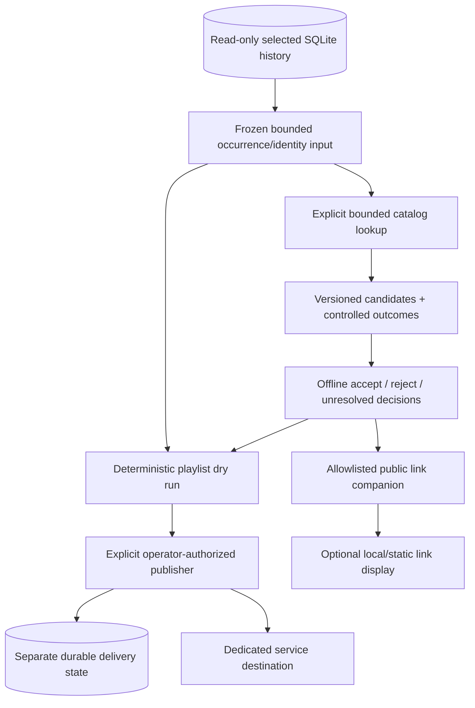

# Phase 4 execution plan: catalog links and optional playlists

Status: software execution completed within the capability-dependent scope recorded in the [ledger below](#software-execution-ledger). The original design sections retain the proposed boundaries and interfaces; use [music outputs](music-outputs.md) for implemented commands and [verification](phase-4-verification.md) for actual checks. Official service documentation was reviewed on 2026-10-25. Account creation, credentialed requests, playlist activation and public deployment remain separate actions. [Current status](status.md) remains the software/acceptance entry point.

## Outcome and boundaries

Turn an explicitly selected saved music history into reviewed Spotify/Apple Music catalog links and reproducible playlist plans. Add bounded independent delivery where the operator's service/account supports the required operations. Attendees keep the account-free music-history page; the destination service controls listening access. Service failures must not stop recognition, rewrite evidence or make a saved analysis unsuccessful.

The phase has three separately reported outcomes: offline software completion, enabled service capabilities and real account acceptance. Matching/review/dry-run software can be completed without credentials or a longer recording. A mocked publisher does not establish live playlist delivery, public sharing or event readiness. A representative room-recording trial remains independently pending.

Initial scope: one explicit database/workspace and successful analysis, closed saved occurrences, an explicit Spotify market or Apple storefront, operator-owned dedicated destinations and batch CLI operations. Supported `completed_partial` inputs retain their coverage/censoring. Preview/running/failed analyses require their existing reconstruction workflow before publication. Start with the whole selected closed history; automatic multi-run/room merging, heat/DJ playlist inference and a background scheduler are excluded.

Do not add playback, previews/audio downloads, scraping, recommendations, ML matching, attendee service login, a public OAuth callback, independent capture or dual-feed work. Do not infer a recording's duration from the short ballroom occurrence. The source audio and raw recognition payloads are unnecessary for this phase and must not be uploaded to catalog services.

## Existing implementation that shapes the design

- `Track.external_mappings` already participates in canonical resolution through `resolution.py`. Automatically adding playlist matches there could alter future recognition conclusions. Keep Phase 4 output mappings separate; changing canonical identity still uses the existing explicit review mechanism.
- Historical display identity comes from saved resolution snapshots, not today's mutable catalog. Bind mappings to that saved identity and its metadata fingerprint, including the selected branch/workspace.
- The Phase 3 projector is a bounded recent-history surface, normally 50 and at most 200 rows. It is not a full-event playlist extractor. Read the explicitly selected evidence through a separate bounded read-only extraction contract.
- Public DTOs and publication bundles have strict field/file closure. Do not add service URLs to schema-1 responses or extra files to schema-1 bundles silently.
- Reuse output path protection, controlled errors, finite HTTP/request limits, exclusive artifacts and destination/state locking concepts. Do not reuse AudD recognition execution or assume Sheets and playlists have identical reconciliation semantics.
- Preserve schema 10, earlier exports/reports, default view bytes and all completed plans. No core evidence migration is proposed. Private Phase 4 artifacts and delivery state belong outside the source SQLite database.

## Service findings and capability decisions

These observations guide implementation; recheck the current references and the actual account before enabling network capabilities.

| Service | Verified documentation / planning consequence |
| --- | --- |
| Spotify access | Development mode requires an app-owner Premium account and limits newly authorized users. February endpoint migration information has a March postponement for existing integrations; the July changelog separately changes app-count/quota behavior. Record app mode and supported endpoints rather than treating one historical announcement as the complete current contract. See [quota modes](https://developer.spotify.com/documentation/web-api/concepts/quota-modes), [migration guide](https://developer.spotify.com/documentation/web-api/tutorials/february-2026-migration-guide), [March update](https://developer.spotify.com/blog/2026-02-06-update-on-developer-access-and-platform-security) and [July changes](https://developer.spotify.com/documentation/web-api/references/changes/july-2026). |
| Spotify discovery/auth | Search supports recording/artist filters, ISRC and market selection; the current reference caps results per type at ten. Catalog-only client credentials do not authorize user playlist operations. Use the appropriate operator OAuth grant and minimum scopes. See [search](https://developer.spotify.com/documentation/web-api/reference/search), [authorization](https://developer.spotify.com/documentation/web-api/tutorials/building-with-ai) and [redirect rules](https://developer.spotify.com/documentation/web-api/concepts/redirect_uri). |
| Spotify delivery | Current references expose playlist `/items` operations; replacement accepts up to 100 items per request. Do not assume a returned `snapshot_id` provides compare-and-set protection for every mutation. Verify semantics for the chosen operation. See [replace/reorder](https://developer.spotify.com/documentation/web-api/reference/reorder-or-replace-playlists-items), [playlists](https://developer.spotify.com/documentation/web-api/concepts/playlists) and [relinking](https://developer.spotify.com/documentation/web-api/concepts/track-relinking). |
| Apple authorization | Personalized API requests need a Music User Token in addition to developer authorization. Developer keys/token acquisition and subscriber eligibility must be established for the operator, not attendees. See [MusicKit](https://developer.apple.com/musickit/) and [user authentication](https://developer.apple.com/documentation/applemusicapi/user-authentication-for-musickit). |
| Apple delivery | Documented operations include creating a library playlist, adding tracks at its end and reading a library playlist. Create/add documentation warns about delayed library visibility. A library ID, editability and a publicly shareable catalog URL are separate facts. Implement only capabilities verified for that destination; do not assume Spotify-style replacement/removal. See [create](https://developer.apple.com/documentation/applemusicapi/create-a-new-library-playlist), [append](https://developer.apple.com/documentation/applemusicapi/add-tracks-to-a-library-playlist) and [read](https://developer.apple.com/documentation/applemusicapi/get-a-library-playlist). |

The public attendee page makes no catalog API calls. Development-account access is not a promise of public app approval or unlimited event-scale API capacity. Spotify quotas, Apple visibility delays, metadata retention/attribution requirements and URL sharing need their own recorded capability decisions. No workaround through unofficial endpoints or extra apps/accounts is part of this plan.

## Architecture and proposed interfaces

Proposed command names below are planning interfaces, not implemented commands. Freeze actual arguments and versioned schemas in step 2 before parallel implementation.

| Proposed command | Boundary |
| --- | --- |
| `plan-catalog-matches` | Offline read-only selection/frozen query plan; no token or network |
| `collect-catalog-matches` | Explicit service metadata requests under request/time/page limits; no playlist writes |
| `review-catalog-matches` | Offline validation of explicit decisions into a new accepted mapping artifact |
| `plan-playlist` | Offline deterministic playlist content and delivery preview from accepted mappings |
| `publish-playlist` | Explicit credentialed reconciliation of one frozen plan into a designated destination |
| `show-playlist-delivery` | Read local delivery state without contacting a service |
| `export-music-links` | Offline public-safe links from approved mappings and separately approved public playlist URLs |

Suggested modules: `music_catalog.py` for shared contracts, `catalog_spotify.py` and `catalog_apple.py` for narrow adapters, `catalog_review.py`, `playlist_plan.py`, `playlist_delivery.py`, `playlist_state.py`, `music_links.py` and thin `cli_music.py`. Split by actual responsibility; avoid a generic integration framework or changing existing method dispatch for an optional output.

## Step 1: establish baseline and service capabilities

1. Capture source/environment versions, current help, all existing test identities and hashes of completed plans/verification records. Retain the existing frozen corpus; do not regenerate it. The last full application baseline is 1,915 passed / one skipped; 13 documentation-tool cases were subsequently verified separately. Collect the current suite to establish the exact starting identities.
2. Produce a service capability matrix covering catalog search/get, market/storefront semantics, ownership/editability, playlist reads/pagination, replace/append/remove/reorder/create, public URL discovery, authorization/refresh, quotas, error formats and metadata retention/display constraints.
3. Mark each capability as documented, implemented in mocks, or verified on the designated real account. These are different evidence levels. Describe unavailable/uncertain operations explicitly.
4. Record API paths/response fixtures and source URLs/date, including newer changelogs. Never probe real credentials just to complete the offline baseline.
5. Choose Spotify as the initial mutable-mirror implementation if its capabilities are available. For Apple, implement catalog matching and dry-run export regardless of publisher readiness; default to a fresh, designated empty playlist for a frozen snapshot unless safe mutation capabilities are demonstrated.

Deliverable: a capability decision and bounded execution baseline. If service access is unavailable, continue independent offline work and report the disabled live capability. A required publish capability that cannot be supported needs a documented scope decision; do not silently mark it implemented.

## Step 2: freeze selection, artifacts and bounds

Define strict version-1 private artifacts for selection/query plans, candidate collections, mapping decisions, accepted mappings, playlist plans and delivery state. Reject duplicate JSON keys, non-finite values, unsupported versions, unexpected fields and oversized content. Use exclusive creation for immutable artifacts, publish completion manifests last, and preserve incomplete artifacts as incomplete. Mutable delivery state is a distinct atomic file with locks.

Selection must bind database/workspace, run, saved identity snapshots, closed occurrence IDs/order, source timeline, analysis/coverage state, catalog policy version and selected service/market. Validate eligible lineage/checkpoint ownership using existing domain boundaries. Extract in one consistent bounded read-only snapshot, then close it before network access or waits. Freeze the exact selected history: later commits, reviews or catalog changes must not change an already prepared plan.

Candidate collections record completed/partial execution and an explicit outcome per identity: candidates, no result, unavailable, unsupported or controlled service error. An unqueried identity is not a no-match. A partial collection can support only explicitly covered decisions and must list every uncovered/excluded occurrence in a later dry run.

Mapping keys include saved identity fingerprint, service and market/storefront. Store reviewed target ID, relevant validated metadata/version facts, provenance, decision policy and availability check time. Existing service IDs are hints requiring validation. Do not modify `track_mappings`, resolution snapshots, original raw candidates or Phase 2 identity review fields.

Proposed first operating bounds are defaults to verify, not measured capacity:

| Resource | Initial bound |
| --- | --- |
| Closed occurrences per frozen selection | Default 1,000; explicit maximum 5,000 |
| Distinct saved identity fingerprints | Default 100; maximum 500 |
| Catalog candidates | At most two queries and twenty retained candidates per identity; service pagination bounded separately |
| Private artifact | At most 16 MiB, with bounded text/IDs and explicit refusal on overflow |
| Catalog HTTP requests | Default 300; explicit maximum 3,000, including detail fetches/auth-related calls in the declared budget |
| HTTP/time scheduling | Five-second connect and ten-second other operation timeouts; default 120-second scheduling budget, maximum 600 seconds |
| Playlist content | Maximum 500 accepted ordered items initially; refuse excess rather than silently trim |
| Delivery requests/attempts | Default twenty requests, three attempts, 120-second scheduling budget; explicit bounded overrides |

Create tests for every bound, including row/byte/count refusal before network or artifact ownership changes. Public projections retain existing tighter page/byte constraints.

## Step 3: implement bounded catalog adapters

Implement service-neutral read interfaces for search and exact target validation, backed by deterministic fixtures. Add Spotify first, then Apple with the same result contract and explicit capability differences. Use fixed official HTTPS hosts/paths; reject credential forwarding, arbitrary returned pagination hosts, redirects and response-schema ambiguity. Bound response bytes, queries, pages and candidates.

Use trustworthy saved recording identifiers where available, followed by title/artist/version-aware queries. Do not invent an ISRC or extract arbitrary provider payload fields as trusted metadata. Validate identifier formats and fetched target types. For Spotify retain original/requested versus market-relinked IDs; for Apple distinguish catalog song IDs from private library item IDs. Do not substitute an unavailable recording automatically.

Preserve remix/edit/live/acoustic/cover and clean/explicit distinctions. Ignore superficial punctuation/case for candidate retrieval without deleting meaningful version words. Treat duration as supporting evidence only when an independent full-recording duration exists; a 77-second dance excerpt cannot establish the commercial recording's duration.

Handle 401/403, 404, 429/Retry-After, 5xx, timeouts and malformed responses with controlled categories. A quota-exhausted account is not necessarily a short rate-limit delay. Use finite backoff/jitter only for safe reads within budgets. No hidden HTTP transport retry or token/provider text in artifacts/logs. Do not suppress an unexpected programming exception as a catalog no-match.

Deliverable: both catalog adapters, strict fixtures, installed CLI collection and deterministic offline replay of collected candidates. Live HTTP remains opt-in.

## Step 4: implement explicit matching review

Separate candidate ranking from accepted output mappings. Ranking uses declared deterministic evidence rules, not an invented provider confidence or uncalibrated percentage. Initial new search matches require an explicit accept decision; the operator can reuse a previously reviewed mapping only for the identical saved identity/service/market with a fresh availability check as required by policy.

Review documents bind candidate artifact digest and exact identity fingerprint, target ID or unresolved/rejected decision, reviewer and rationale. Missing, duplicate, foreign or inconsistent choices are refused. Accepting a catalog version does not review acoustic recognition, timing, DJ attribution or classification. Any correction of the actual saved identity first uses the existing Phase 2 revision workflow and a newly selected branch.

Keep all candidates and earlier decisions. Rejection/unresolved removes the target only from new output plans; it does not delete old evidence or mutate a published playlist by itself. Two different saved identities mapping to one service recording require an explicit collision policy/decision, not an automatic canonical merge.

Deliverable: reviewable candidate report, strict review input and immutable accepted-mapping artifacts. Test original/remix, covers, featured artists, duplicate releases, ISRC/metadata conflicts, unavailable targets, missing version information and reviewed-branch invalidation.

## Step 5: build deterministic playlist dry runs

Create playlist content from the frozen full selected history, not the recent browser page. Default policy is unique accepted service recordings ordered by first occurrence, using a stable frame/event-index tie-break. The private report retains all source occurrences and explains repeated items removed from the listening list. An optional preserve-occurrences policy may be added only with explicit versioned semantics and tests; do not conflate retry duplication with a real repeat.

List every excluded/unmapped/unavailable identity and its affected occurrence count. Preserve input partial coverage and censoring; a complete delivery of a partial history must not look like a full event playlist. Bind source/selection, accepted decisions, market/storefront, ordering/deduplication policy, desired target sequence and digest. No network, token or destination mutation occurs in a dry run.

Use a separate destination binding: service, operator account identity, playlist ID, capability profile, desired privacy and local state location. The immutable content digest can be replayed independently of delivery bookkeeping. Reject IDs belonging to another service/account or a different bound state; refuse database and reserved sidecar paths before creating any output or lock.

Deliverable: a complete human-reviewable plan with desired additions/removals/order, exclusions, limits and the safe delivery strategy. This should be useful even when neither live publisher is enabled.

## Step 6: add operator authorization and ownership boundaries

Implement a narrow credential provider separate from artifact parsing and delivery state. Begin with privately supplied short-lived tokens; support in-memory OAuth refresh only through a separately specified token provider. Do not store secrets in ordinary JSON artifacts or print tokens as setup output. If durable refresh credentials are needed, choose a reviewed OS credential-store mechanism rather than silently saving plaintext. Token expiry/revocation must leave an inspectable pending result.

Spotify user operations need the operator's appropriate grant/scopes. If an authorization helper is implemented, use Authorization Code with PKCE (or a justified confidential backend flow), state validation and a temporary loopback IP callback with a deadline. Keep it separate from the fixed read-only attendee server. Catalog client credentials cannot authorize playlist writes. Apple token acquisition may use its approved MusicKit tooling; never put a developer private key or Music User Token into the public page.

Require a designated dedicated playlist and verified authenticated ownership/editability before replacement. Do not adopt a nonempty unknown playlist automatically. Retain a separate local destination record and shared lock keyed by service/account/playlist across different state paths. Document one publisher across hosts; local locking and service snapshots are not universal distributed exclusion.

Real app registration, subscriptions, credentials and destination activation require operator input only when doing that external action. Their absence must not block offline contracts, review, dry runs or mock delivery tests.

## Step 7: implement service-aware delivery and reconciliation

Before each mutation, persist the desired plan/digest, target/account, observed remote baseline and intended operation. Read the complete bounded remote sequence with validated pagination and detect null, unavailable, local-file or unexpected item types. A truncated or malformed successful response must never authorize replacement or establish emptiness. Release the source database read transaction before any HTTP.

For Spotify, reconcile an explicitly owned dedicated playlist with fixed desired content. The first implementation handles at most one documented replacement batch, then expands within this phase to the 500-item cap using persisted replacement/append operations. Journal each operation before dispatch and read back before advancing. Larger updates are not atomic; an interruption can leave a known prefix that must be reconciled to the same frozen plan before switching generations. Readback of the full final sequence and intended visibility is required for `delivered`.

For Apple, start with a frozen snapshot into a designated empty editable library playlist. Add bounded batches only under verified append/read capabilities. Corrections/reordering that cannot be supported safely require a newly designated empty playlist and explicit replacement of the advertised link; do not pretend the old playlist was updated. If replace/remove is later demonstrated and enabled, add it as a separate capability with its own failure tests. Never assume a library playlist ID can be converted directly into a public URL.

Timeouts after append/create have an unknown commit outcome. Do not blindly retry them. Reconcile against the journal and fully read observed sequence; if delayed visibility means both committed and uncommitted outcomes remain possible, retain pending/unknown and stop writes. Bounded polling may confirm a known intended sequence; absence after a delay is not proof an append failed. Automatic playlist creation is optional; unknown creation must not trigger another creation or guessed adoption. The initial operator-designated-ID path avoids requiring creation recovery.

Remote manual edits or unexpected sequences cause conflict and stop; no force overwrite in the initial release. Successful ownership/read checks cannot prevent an unsupported simultaneous external writer, so require exclusive operator coordination. Handle quota, auth, schema, readback, cancellation and disk/state-write failures with explicit attempt/request counts and preserved pending state. Never issue a write after failure to persist intent. Disable hidden write retries and stop scheduling requests/sleeps after budget expiry.

Deliverable: mocked Spotify mirror and capability-limited Apple snapshot delivery, restart/unknown-commit controls, read-only local state inspection and an explicit live acceptance procedure. A disabled/unsupported publisher stays labeled as such.

## Step 8: expose safe song and playlist links

Export a separate versioned public-safe link companion keyed by opaque occurrence keys and bound to the selected view generation. Include only accepted service label/target URL and explicitly approved public playlist links. Keep candidate alternatives, reviewer/rationale, account/private library IDs, paths, tokens, query plans and delivery errors private. Validate HTTPS hosts/path types, URL length, absence of userinfo/token/query surprises and safe rendering with literal text and appropriate link attributes.

Keep the default schema-1 metadata projection/API/config response byte-compatible. The proposed opt-in design uses a separately selected private configuration with a links-manifest reference, a fixed companion endpoint and an explicit HTML data hook. An unconfigured page makes no additional catalog/companion request. Freeze this configuration/companion interface in step 2; links must never select a database/run or cause service HTTP inside a view request.

The browser applies links only when companion/view generation and occurrence keys agree. Missing, expired, malformed or mismatched companions hide links without breaking history or replay. Accepted catalog links are independent of playlist delivery; a playlist link appears only after an explicit public-sharing check. Do not label a pending/private Apple library playlist as attendee-accessible.

Static publications with links need a new bundle format with an explicit fixed `links.json` member and version-dispatched verification. Keep schema-1 bundle closure unchanged; never rehash/edit existing publications to add links. Preserve expiry/withdrawal behavior, strict asset matching, metadata-only privacy and existing response byte limits. Publishing with links is opt-in and separately tested; Sheets retains its current fourteen-column contract.

Deliverable: local/mobile and optional static song/playlist links, with browser privacy/availability tests and no attendee OAuth, playback SDK or third-party asset dependency.

## Step 9: verify, document and hand off

| Gate | Required evidence |
| --- | --- |
| Selection/contracts | Original/partial/reviewed/checkpoint inputs, frozen snapshots, explicit coverage, no mutable catalog substitution, bounded full-history extraction and read-only database hashes |
| Catalog/review | Both services, meaningful version distinctions, missing/contradictory metadata, market/relink/library-ID cases, unavailable targets, strict JSON/URL/pagination validation and decision lineage |
| Plans | A-B-A repeats, service-ID collisions, deterministic ordering/digests, >100 items, omissions/partial coverage and refusal of excessive rows/bytes |
| Delivery | Ownership mismatch, concurrent local publishers, outside edits, auth/quota failures, malformed empty reads, intent-write failure, unknown commit before/after acknowledgement, delayed visibility, process restart and finite budgets |
| Isolation | Collector commits while catalog/output fails; no new recognition calls, source audio access, evidence changes or leaked secrets |
| Public surfaces | Version-1 compatibility, link binding/expiry, hostile text/URLs, phone/desktop Chromium, optional companion failure, schema-1/2 bundle closure and publication withdrawal |
| Release | Existing test identities pass, frozen historical reports/files match, existing command help stays unchanged, new root help is reviewed, completed plans/records remain unchanged, wheel includes new modules/assets and offline CLI still works without web extras |

Run focused tests per slice, then one coherent full release regression and exact compatibility gate. Keep network blocked in deterministic tests. Separate resource probes from heavy tests and cover the proposed maximum selection/candidate/playlist sizes before declaring those bounds supported.

Add current guides for catalog review, playlist planning/delivery and operator authorization. Update status, task index, developer map and roadmap with actual implemented versus enabled capabilities. Record a completion ledger and limitations, including any unavailable Apple mutation/sharing support or Spotify access restrictions.

Real acceptance requires separately authorized accounts/destinations. Use a small independently reviewed fixture set: original/remix distinction, repeated song, ambiguous/unavailable target, changed mapping and an interrupted delivery. Verify readback and actual attendee URL access. Record requests, supported account mode, market/storefront, tokens/scopes without secret values, and observed sharing behavior. Do not create deliberate service failures or overwrite personal playlists to exercise a test.

## Execution order and completion criteria

Deliver steps 1-2 first as the shared contract. Steps 3-4 establish matching/review; step 5 delivers an immediately useful offline export. Steps 6-7 enable optional delivery; step 8 adds attendee links; step 9 completes software verification and hands off real acceptance. If delegation is explicitly requested, separate Spotify/Apple adapters only after the shared contracts freeze; keep core selection/state/public-schema changes under one integrator with an independent read-only review of delivery safety.

The first implementation assignment should cover steps 1-2: the capability record, baseline, immutable selection/query schemas, fixture contract and exact proposed CLI interfaces. Do not start account enrollment or remote writes as part of that assignment.

Phase 4 software is complete when supported closed history can be frozen, matched/reviewed against both catalog contracts, rendered into deterministic explainable playlist plans, delivered safely by every enabled publisher and displayed through approved links, with historical compatibility preserved. Report any capability branch that remains deferred or unavailable; do not count it as a successful live integration. Public deployment, room-acoustic acceptance, richer inference and independent live capture remain their separate gates/phases.

## Software execution ledger

Implemented 2026-10-25 using an orchestrator and three medium-effort agents with separate module ownership and independent read-only safety reviews. The [capability decision](phase-4-capabilities.md) records supported versus unavailable operations; the [verification record](phase-4-verification.md) records exact checks. Existing completed plans and verification records were preserved.

Final software verification and handoff completed 2026-10-26: 2,299 tests passed/one existing skip, all historical compatibility checks passed, and a separately installed wheel matched 76 runtime files. Maximum probes retained 5,000 occurrences/500 identities and exercised 500-target delivery through mocked HTTP. Real accounts, Apple HTTP publishing and public playlist sharing remain the explicit capability/acceptance limits below. This plan now joins the completed historical plans; current operating instructions remain in the linked guides.

| Step | Delivered scope |
| --- | --- |
| 1. Baseline and capabilities | Captured prior test identities/help/protected hashes; documented current API contracts, access restrictions and unsupported Apple account binding |
| 2. Frozen inputs | Bounded full closed-history selection from saved snapshots; strict immutable query/collection/review/plan artifacts; source timeline/coverage and opaque occurrence keys; separate durable destination state |
| 3. Catalog adapters | Spotify and Apple fixed-host bounded search/get; controlled failures; explicit market/storefront; no automatic retries, audio access or catalog acceptance |
| 4. Review | Exact collection-bound per-identity decisions; collision policy; retained collection time/source outcomes; preserve canonical identities and reviewed branches |
| 5. Dry runs | Unique accepted targets in first-occurrence order; all occurrences retained with inclusion and independent catalog-coverage explanations; 500-target cap |
| 6. Authorization | Privately supplied process tokens; explicit owner/destination/visibility; local shared destination/state locks; no OAuth/refresh helper |
| 7. Delivery | Mock-verified Spotify HTTP plus per-target fresh metadata validation; durable intents, batches, complete readback, conflict/unknown-commit stops; Apple snapshot protocol mocked, HTTP disabled |
| 8. Links | Strict expiring song-link companion; opt-in fixed-route local/LAN browser view; schema-2 static bundle verification/withdrawal; default schema-1 views and Sheets unchanged |
| 9. Handoff | Current operator/developer documentation, targeted/Chromium checks, full regression and retained compatibility/package evidence in the linked verification record |

Conservative refinements: one query or saved-ID lookup with ten first-page candidates per identity; explicit review instead of automatic ranking; Spotify relinks refused instead of substituted; pre-publish exact target revalidation instead of cached availability reuse. Catalog completion time and per-identity source outcomes survive review/planning. Song links represent historical approved destinations with current availability unknown; renewing a display expiry is not a fresh catalog check. Collection budget defaults to 300 physical requests/120 seconds, maximum 3,000/600; delivery separately bounds logical operations to twenty by default, at most 100, without hidden retries. There is no automatic three-attempt retry loop.

Apple HTTP delivery remains unavailable until stable authenticated account binding is designed and verified. Public playlist link export is deferred until sharing approval/access can be demonstrated; approved recording links work independently. Automatic playlist creation, OAuth refresh, background synchronization, real service account acceptance and public deployment were not performed. These limitations are explicit capability outcomes, not claims of successful live integration.
